<h1 align="left">Hi 👋, I'm Luis Filipe Crivellaro</h1>

###

<h6 align="left">Apaixonado por desenvolvimento de software, algoritmos e design. Sou Estudante de Engenharia de Software na FIAP - São Paulo, Brasil. Foco em resolução de problemas e construção de soluções inovadoras. 🌱 I’m currently learning 📌 Desenvolvimento Full Stack – Aprimorando minhas habilidades em React, Node.js e bancos de dados. 📌 Inteligência Artificial – Investigando Machine Learning e Data Science para aplicar em projetos inovadores.  💬 Ask me about ❓ Desenvolvimento Full Stack com Node.js e React ❓ Soluções sustentáveis como o Ecopiso ❓ Tecnologias emergentes como IoT e Inteligência Artificial  📄 Know about my experiences 🔋 Ecopiso – Um piso gerador de energia sustentável, capaz de converter a energia cinética das pessoas em eletricidade, promovendo eficiência energética e impacto ambiental positivo. 📡 IoT Sustentável – Projeto focado em redução do consumo energético através de sensores inteligentes e automação.  ⚡ Fun fact 💪 Apaixonado por musculação – Sempre buscando evolução dentro e fora da academia. 🥁 Baterista nas horas vagas – Nada como um bom som para equilibrar a rotina tech!</h6>

###

  
  

###

  
  
  
  
  
  
  
  
  
  
  
  
  

###

  
  
  

###

###

 

###
